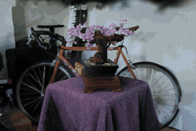

# gaussian-splat-rasterizer

A 3D Gaussian Splatting renderer in Rust on [vulkano](https://github.com/vulkano-rs/vulkano),
with shaders written in [Slang](https://shader-slang.org). It loads standard 3DGS `.ply`
files (SH degree 0–3) and renders them in an interactive viewer or headless to PNG. Ten
debug views take a trained scene apart.

<p align="center">
  
</p>

## Requirements

- Rust (2024 edition) and a Vulkan 1.3 driver (or `VK_KHR_dynamic_rendering`)
- Vulkan SDK: shaders are compiled at build time with `slangc`, found via `$SLANGC`,
  `$VULKAN_SDK/Bin`, or `PATH`

## Quick start

```bash
python scripts/fetch_data.py
cargo run --release -- data/bonsai/point_cloud.ply
```

Headless:

```bash
cargo run --release -- data/bonsai/point_cloud.ply --out out/bonsai.png --size 1280x720
cargo run --release -- data/bonsai/point_cloud.ply --out out/bonsai.png --view all
cargo run --release -- data/bonsai/point_cloud.ply --out out/tt.png --turntable 60
```

Viewer controls: left-drag orbit · right-drag pan · wheel zoom ·
N / P next / previous dataset camera · R reset · Esc quit.
Run with `--help` for all options.

## Debug views


*Bonsai, dataset camera 0. Badges show the viewer key; numbered callouts mark the
features each caption mentions.*

Some background helps when reading these. Each splat is a 3D Gaussian with a
center, a covariance (per-axis scale plus a rotation), an opacity, and a color
stored as spherical harmonics (SH). The renderer projects each Gaussian to a 2D
ellipse on screen, rasterizes a quad covering ±3σ, and computes
`alpha = opacity · exp(-½·d²)` per pixel. The splats are then alpha-blended from
back to front.

| Key | View | What it shows | What to look for |
|-----|------|---------------|------------------|
| `1` | **color** | The final render. In the viewer, this key also resets every knob below. | — |
| `2` | **base-color** | SH band 0 only: the color a splat has from every direction. | It is almost identical to `color`, so most of the appearance is view-independent. |
| `3` | **view-dependent** | SH bands 1–3 only, as an offset from mid-grey. | Specular highlights on the wheel rims and spokes move as you orbit. Grey (the cloth) means the surface looks the same from every angle. |
| `4` | **depth** | Alpha-blended expected depth (Turbo colormap, log scale; red is near, blue is far). | The geometry the optimizer actually found. The bonsai is crisp, while background walls are semi-transparent smears spread over many depths. |
| `5` | **opacity** | Each splat's opacity as a color, drawn as if fully opaque. | *Floaters*: large, faint (blue) splats hanging in front of the camera. The opaque (red) splats sit on real surfaces such as the flowers. |
| `6` | **ellipses** | The 1σ and 2σ outline of every splat's projected ellipse. | Splat size follows detail: tiny on the flowers, huge on flat background. |
| `7` | **centers** | Every splat center as a 2.5 px dot: the underlying point cloud. | The gaps between centers show that the Gaussians' extent, not point density, is what covers the surfaces. |
| `8` | **anisotropy** | The ratio of the ellipse's major to minor axis (blue is round, red is 10:1 or more). | Long, thin "needle" splats line up along edges and thin structures (the wooden stand). The cloth is made of round blobs. |
| `9` | **overdraw** | An additive count of the blended fragments per pixel (dark → red → orange → white at 50+ layers). | This is the fill cost. The bright regions (cloth, table) are where frame time goes. |
| `0` | **quads** | The ±3σ quads actually sent to the rasterizer. | Some background splats cover a large part of the screen, which is why tile-based renderers cull or cap them. |

Knobs, which combine with any view:

| Key | CLI | Effect |
|-----|-----|--------|
| `[` / `]` | `--splat-scale <s>` | Multiply every Gaussian's size. At 0.2–0.4 the scene breaks apart into individual blobs. |
| `-` / `=` | `--min-opacity <a>` | Hide splats below an opacity threshold. Around 0.5, most floaters disappear. |
| `H` | `--sh <deg>` | Cap the SH degree (0–3). Degree 0 turns off all view-dependent shading. |
| `B` | `--bg r,g,b` | Cycle the background between black, grey and white. |

[docs/debug-views.md](docs/debug-views.md) has more detail and a few guided experiments.
Regenerate the images with `python scripts/make_view_grid.py` and
`python scripts/make_turntable_gif.py`.

## How it works

1. `src/ply.rs` parses the PLY, applies the activations, and precomputes the 3D covariances.
2. `src/renderer.rs` sorts splats by view depth on the CPU with a counting sort (back to front).
3. `src/shaders/splat.slang` (`vsMain`), per instance: projects the covariance (EWA),
   evaluates the spherical harmonics, and emits a quad aligned with the 2D eigenvectors.
4. `src/shaders/splat.slang` (`fsMain`): Gaussian falloff and premultiplied alpha blending.

Planned work (GPU sort, compute preprocess, a tile rasterizer, tests) is tracked in
[docs/ROADMAP.md](docs/ROADMAP.md).

## Data

Sample scenes are not included in the repo. `scripts/fetch_data.py` downloads them from
the Hugging Face dataset [dylanebert/3dgs](https://huggingface.co/datasets/dylanebert/3dgs).
Bonsai is a pretrained 3DGS model of the Mip-NeRF 360 bonsai scene.

## License

Licensed under either of [Apache License, Version 2.0](LICENSE-APACHE) or
[MIT license](LICENSE-MIT) at your option.
