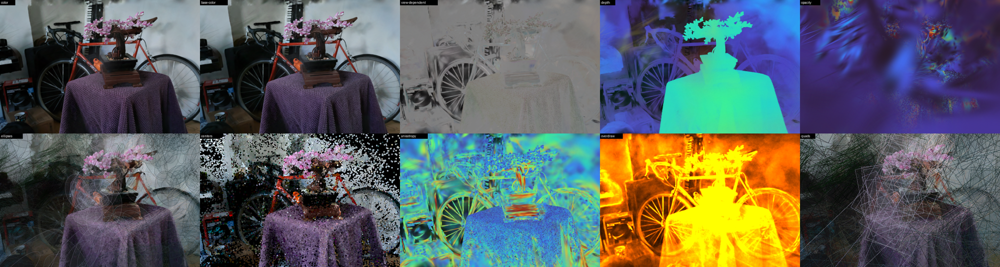
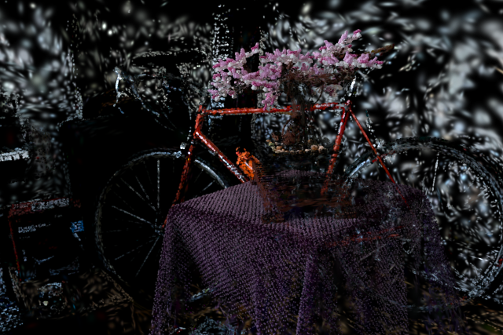

# Debug & visualization views

A guide to taking a 3D Gaussian Splatting scene apart. Every view is
available live in the viewer (number keys) and headless (`--view <name>`;
`--view all` writes one PNG per view).

```bash
cargo run --release -- data/bonsai/point_cloud.ply --view depth
cargo run --release -- data/bonsai/point_cloud.ply --out out/b.png --view all
```



*Top row: color, base-color, view-dependent, depth, opacity.
Bottom row: ellipses, centers, anisotropy, overdraw, quads.*

## What a splat is

Each splat is a 3D Gaussian: a center, a 3×3 covariance (built from a
per-axis scale and a rotation quaternion), an opacity, and a color stored as
spherical-harmonic (SH) coefficients. To render it, the covariance is
projected to a 2D ellipse on screen (the EWA Jacobian in `vsMain`), a quad
covering ±3σ along the ellipse axes is rasterized, and each pixel gets
`alpha = opacity · exp(-½·d²)`, where `d` is the distance from the center in
standard deviations. Splats are sorted by depth and alpha-blended from back to
front.

## The views

| Key | View | What you are looking at | What to notice |
|-----|------|-------------------------|----------------|
| 1 | `color` | The final render. | — |
| 2 | `base-color` | Only SH band 0, the color that is the same from every direction. | Almost identical to `color`: most appearance is view-independent. |
| 3 | `view-dependent` | Only SH bands 1–3, shown as an offset from mid-grey. | Highlights and reflections (bike frame, wheel rims, the pot's glaze) change as you orbit. Grey means "no view dependence". |
| 4 | `depth` | Alpha-blended expected depth with a turbo colormap (red = near, blue = far, log scale between the 2nd and 98th percentile). | The geometry the optimizer actually found. Background "walls" are often semi-transparent smears at the wrong depth. |
| 5 | `opacity` | Each splat's opacity as a color, drawn as if fully opaque. | Big, faint (blue) splats in front of the camera, called *floaters*, plus a few dense, opaque (red) ones on surfaces. |
| 6 | `ellipses` | 1σ and 2σ outlines of every splat's screen-space ellipse. | Size and orientation spread: tiny splats on detailed areas, huge ones on flat background. Use with `[` and `-` to declutter. |
| 7 | `centers` | Each center as a 2.5 px dot: the raw point cloud. | Density follows detail; flat walls are sparse. Gaussians, not points, carry the coverage. |
| 8 | `anisotropy` | Screen-space major/minor axis ratio (blue = round, red ≥ 10:1). | Thin "needles" line up along edges (wheel spokes, table edge). |
| 9 | `overdraw` | Additive count of fragments per pixel that pass the alpha cutoff (dark → red → orange → white ≈ 50+ layers). | This is the fill cost. Bright areas are where frame time goes. |
| 0 | `quads` | The ±3σ quads actually sent to the rasterizer. | Some background splats cover much of the screen; this is why tile-based renderers cap or cull them. |

## Knobs

| Key | CLI | Effect |
|-----|-----|--------|
| `[` / `]` | `--splat-scale <s>` | Multiply every Gaussian's scale. At 0.2–0.4 the scene falls apart into its individual blobs. |
| `-` / `=` | `--min-opacity <a>` | Hide splats below an opacity threshold. Above about 0.5, most floaters disappear. |
| `H` | `--sh <deg>` | Cap the SH degree (0–3). Degree 0 removes all view-dependent shading. |
| `B` | `--bg r,g,b` | Background black / grey / white. White shows semi-transparent regions clearly. |



*`--splat-scale 0.3 --min-opacity 0.5`: the same scene with every Gaussian at
30% size and low-opacity splats hidden.*

## Suggested experiments

1. **View dependence**: orbit around the bonsai in view 3. The bike frame's
   highlights move with the camera, and the cloth stays grey.
2. **Floaters**: in view 5, raise the min opacity with `=` until the haze
   disappears, then switch back to view 1 to see what the haze was doing.
3. **Fill cost**: zoom into the cloth in view 9 and watch it saturate. Compare
   with the fps in the title bar.
4. **Structure**: press `[` five times in view 1. Splats shrink into a
   "sequin" look, showing how much each one overlaps its neighbours.
