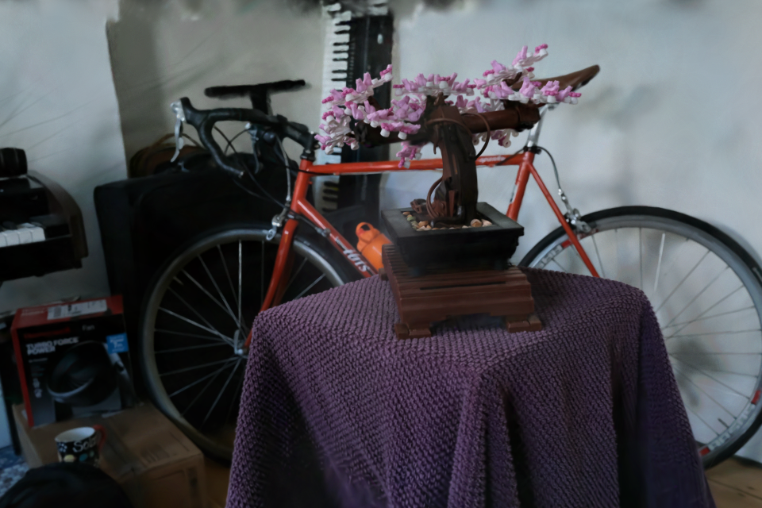

# Core Pipeline — Roadmap

The milestone-1 rasterizer is working end to end: a 3DGS PLY loads into GPU
storage buffers, splats are depth-sorted on the CPU (16-bit counting sort,
only re-run when the view matrix changes), and one instanced draw
(6 vertices × N instances, no vertex buffers) expands each Gaussian into an
eigenvector-aligned quad in `src/shaders/splat.vert`. The fragment shader
evaluates `exp(-0.5·|uv|²)` in eigen-space and blends premultiplied alpha
back-to-front. Both a headless PNG path (`--out`) and a winit viewer exist.

Bonsai (1.16 M splats, SH deg 3) renders correctly from dataset camera 0;
the viewer runs at ~213 fps on a desktop discrete GPU with a static camera. While
the camera moves, the per-frame CPU sort is the expected bottleneck (see
[gpu.md](gpu.md)).

## Decisions

- **Camera convention = COLMAP** (2026-10-01): +x right, +y down, +z forward.
  This equals Vulkan clip-space orientation, so there are no axis flips
  anywhere; `cameras.json` rotations are camera-to-world, given as rows.
  **Normative** for all later tasks.
- **Display-space blending** (2026-10-01): render targets are `*_UNORM`, never
  `*_SRGB`. 3DGS models are trained blending sRGB values directly; an sRGB
  target would double-apply gamma.
- **Covariance precomputed on CPU** (2026-10-01): `Splat` = 48 B
  (pos+opacity, 6 covariance terms). SH stored separately as 48 floats
  `[coeff][rgb]`, zero-filled above the file's degree. Note the PLY's
  `f_rest_*` is channel-major (`[rgb][coeff]`) — reordered at load.
- **Dynamic rendering, not render passes** (2026-10-01): one pipeline works for
  both swapchain and offscreen targets; requires Vulkan 1.3 or
  `VK_KHR_dynamic_rendering`.
- **Up axis** (2026-10-01): derived from the mean camera "down" vector when a
  `cameras.json` exists, else +Y (`--up` overrides).

## Tasks

<!--task
id: CORE-001
status: done
epic: scaffold
deps: []
cl: 1cb2aa1
-->
### CORE-001 — Crate scaffold

Cargo project on vulkano 0.35 / vulkano-shaders / winit 0.30 / glam; GLSL
compiled at build time via the Vulkan SDK's shaderc.

Verify: `cargo build --release` with zero warnings.

<!--task
id: CORE-002
status: done
epic: io
deps: [CORE-001]
cl: 1cb2aa1
-->
### CORE-002 — 3DGS PLY loader

`src/ply.rs`: binary little-endian, properties located by name; activations
applied at load (exp scale, sigmoid opacity, normalized wxyz quaternion);
SH degree inferred from `f_rest_*` count (0/9/24/45).

Verify: luigi (14 526 splats, deg 0) and bonsai (1 157 141, deg 3) load;
bonsai in ~0.27 s.

<!--task
id: CORE-003
status: done
epic: io
deps: [CORE-001]
cl: 1cb2aa1
-->
### CORE-003 — Cameras: dataset JSON + orbit

`src/camera.rs`: `cameras.json` loader, look-at, orbit controller; scene
target = least-squares intersection of the dataset view rays (`src/main.rs`).

Verify: `--orbit 90` on bonsai frames the bonsai from the side.

<!--task
id: CORE-004
status: done
epic: tooling
deps: [CORE-001]
cl: 1cb2aa1
-->
### CORE-004 — Headless capture (`--out`)

Deterministic offscreen render → PNG. This is the basis for every
before/after pair and pixel-diff check on the roadmap.

Verify: `gaussian-splat-rasterizer data/bonsai/point_cloud.ply --out out/b.png`.

<!--task
id: CORE-005
status: done
epic: render
deps: [CORE-002, CORE-003]
cl: 1cb2aa1
-->
### CORE-005 — Instanced splat pipeline with CPU sort

EWA projection (Jacobian clamped to 1.3× frustum, +0.3 px² low-pass),
degree-3 SH in the vertex shader, eigen-aligned 3σ quads, premultiplied
back-to-front blending, counting sort over view depth.

Verify: renders match the expected look with no validation errors
(`VK_INSTANCE_LAYERS=VK_LAYER_KHRONOS_validation` → 0 VUIDs).
Result: [bonsai](img/core-005-bonsai-cam0.png), [luigi](img/core-005-luigi.png).

<!--task
id: CORE-006
status: done
epic: viewer
deps: [CORE-005]
cl: 1cb2aa1
-->
### CORE-006 — Interactive viewer

winit swapchain viewer: left-drag orbit, right-drag pan, wheel zoom, N/P
cycle dataset cameras, R reset; FPS in the title bar.

Verify: viewer stays alive and reports fps (213 fps on bonsai, static).

<!--task
id: CORE-007
status: done
epic: io
deps: []
cl: 59bcc6a
-->
### CORE-007 — Sample data fetch script

`scripts/fetch_data.py` downloads luigi (~1 MB) and bonsai 7k (~287 MB +
cameras.json) from the Hugging Face `dylanebert/3dgs` dataset into `data/`
(gitignored).

Verify: `python scripts/fetch_data.py` is idempotent ("exists:" on rerun).
