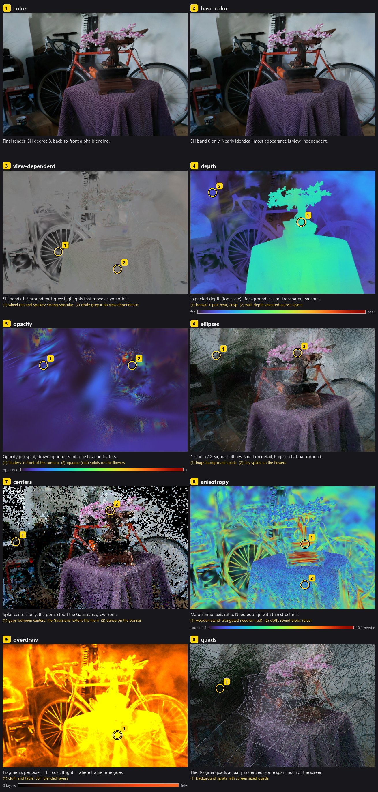

# Shaders & Visualization — Roadmap

Shaders are written in **Slang** (`src/shaders/splat.slang`, entry points
`vsMain` / `fsMain`) and compiled to SPIR-V by `build.rs` with the Vulkan
SDK's `slangc`. The renderer loads the SPIR-V directly; `vulkano-shaders` is
no longer a dependency. Ten debug views plus scale, opacity, SH and
background controls are documented in [../debug-views.md](../debug-views.md).

## Decisions

- **Slang over GLSL** (2026-10-01): one source file holds both stages and is
  compiled per entry point. Conventions, all **normative**:
  - Use `SV_VulkanVertexID` / `SV_VulkanInstanceID`, never `SV_VertexID` /
    `SV_InstanceID`. The HLSL semantics subtract the base vertex/instance,
    which needs the `DrawParameters` capability, and that capability is not
    enabled.
  - Compile with `-matrix-layout-column-major`. Glam's column arrays then
    upload as-is, and `mul(M, v)` means M·v. Slang `floatNxM(...)`
    constructors take their arguments **row by row**.
  - Every push-constant member is 16-byte aligned, so std140 and std430
    layouts agree. `Push` in `src/renderer.rs` mirrors the Slang struct by
    hand: change both together.
- **One shader, mode switch** (2026-10-01): debug views are a push-constant
  mode (`dbg.x`), ordered to match `ViewMode::ALL` in `src/debug.rs`. Only
  `overdraw` needs a second pipeline (additive blend).

## Tasks

<!--task
id: VIZ-001
status: done
epic: shaders
deps: [CORE-005]
cl: fd4b26c
-->
### VIZ-001 — Port shaders from GLSL to Slang

`splat.vert` / `splat.frag` became `splat.slang`, and `build.rs` runs
`slangc` (located via `$SLANGC`, then `$VULKAN_SDK/Bin`, then `PATH`).

Verify: bonsai cam 0 at 1280×853 against the GLSL render: max channel diff
1/255, mean 1e-4. 0 validation errors.

<!--task
id: VIZ-002
status: done
epic: debug-views
deps: [VIZ-001]
cl: fd4b26c
-->
### VIZ-002 — Debug views and knobs

Ten views (color, base-color, view-dependent, depth, opacity, ellipses,
centers, anisotropy, overdraw, quads), plus splat scale, min opacity, SH cap
and background cycling. Bound to keys in the viewer; available headless as
`--view <name|all>`, `--splat-scale`, `--min-opacity` and `--sh`.

Verify: `--view all` writes 10 distinct PNGs; `scripts/make_view_grid.py`
composes the [annotated grid](img/viz-002-all-views-annotated.jpg);
the viewer title shows the active settings (210 fps in overdraw view).

<!--task
id: VIZ-003
status: todo
epic: inspector
deps: [VIZ-002]
-->
### VIZ-003 — Splat picking / inspector

Click a pixel to find the splats that contribute most to it, using an ID
buffer or a CPU re-evaluation along the sorted list. Print their parameters
(position, scales, rotation, opacity, SH DC) and highlight the selected splat.

Verify: clicking the bonsai pot reports a splat whose center projects within
a few pixels of the click.

<!--task
id: VIZ-004
status: todo
epic: debug-views
deps: [GPU-005]
-->
### VIZ-004 — Transmittance and contributor-count views

Per-pixel final transmittance, and the number of splats blended before
T < 1e-4 (early termination). Both are natural outputs of the tile backend.

Verify: transmittance is near 0 on solid surfaces and higher on
semi-transparent background regions.

<!--task
id: VIZ-005
status: todo
epic: debug-views
deps: [VIZ-002]
-->
### VIZ-005 — Split-screen compare

Show two views side by side with a draggable divider (for example color vs
depth, or SH 0 vs SH 3), in both the viewer and headless.

Verify: the headless `--compare color,depth` image shows both halves aligned.
